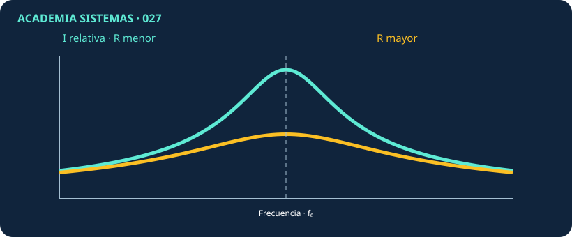

[← Anterior](02.md) · [Índice](../README.md) · [Siguiente →](04.md)

# 027 · Página 3/4 · Amortiguamiento y selectividad

Para RLC serie ideal, Q=ω0L/R y el ancho de banda de media potencia Δf=R/(2πL). Al aumentar R, el pico de corriente disminuye y la curva se ensancha. Sin fuente, la energía se disipa en R; según amortiguamiento, pueden ocurrir oscilaciones decrecientes. En un circuito paralelo el comportamiento de impedancia es distinto; no trasladar reglas de serie sin derivarlas.

> **Comprueba tu comprensión:** Compara curvas de corriente para dos resistencias diferentes.

[← Anterior](02.md) · [Índice](../README.md) · [Siguiente →](04.md)
