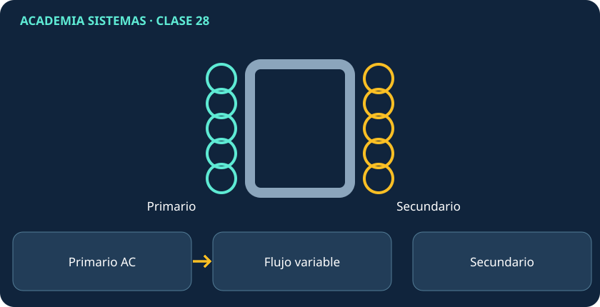

[← Anterior](02.md) · [Índice](../README.md) · [Siguiente →](04.md)

# 28 · 3/4 · Pérdidas

Cobre, histéresis, corrientes parásitas y flujo de fuga alteran modelo. Aislamiento galvánico no hace segura cualquier tensión. Solo simulación de baja tensión.

*Esquema didáctico; no es medición ni plano de montaje.*

> **Comprueba:** Dibuja el mecanismo y explica causa, cambio y conservación con tus palabras.

[← Anterior](02.md) · [Índice](../README.md) · [Siguiente →](04.md)
