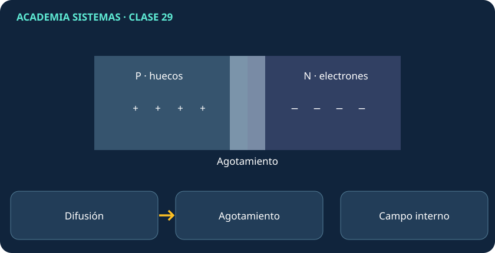

[← Anterior](03.md) · [Índice](../README.md) · [Ejercicios](../ejercicios/README.md) · [Siguiente clase →](../../030-rectificadores/libro/01.md)

# 29 · 4/4 · Ejemplo resuelto

5 V con resistor 1 kΩ y caída 0,7 V: I=4,3 mA.

*Esquema didáctico; no es medición ni plano de montaje.*

> **Comprueba:** ¿N es globalmente negativo?

[← Anterior](03.md) · [Índice](../README.md) · [Ejercicios](../ejercicios/README.md) · [Siguiente clase →](../../030-rectificadores/libro/01.md)
