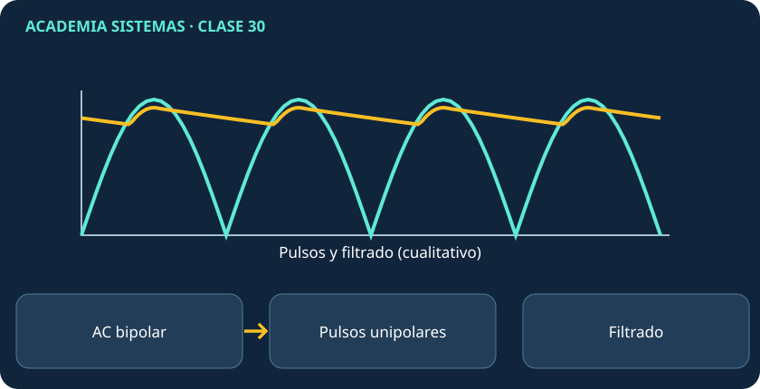

[← Clase 29](../029-union-pn/README.md) · [Índice](../README.md) · [Clase 31 →](../031-zener-regulacion/README.md)

# Clase 30 · Rectificadores y filtrado: ondulación y diodos

**Edición web inicial · 120 minutos orientativos.**

> ¿Qué pasa al duplicar C?

[▶ Comenzar](libro/01.md) · [HTML imprimible](libro.html) · [Materiales](descargas.md)

- [Rectificación](libro/01.md)
- [Filtrado](libro/02.md)
- [Límites](libro/03.md)
- [Ejemplo resuelto](libro/04.md)

[Lectura](lecturas/guia-ampliada.md) · [Ejercicios](ejercicios/README.md) · [Laboratorio](practicas/README.md) · [Evaluación](pruebas/README.md) · [Soluciones](soluciones/README.md) · [Guía docente](guia-docente.md)

> Prácticas virtuales. Nunca conectar red doméstica, abrir fuentes ni provocar cortocircuitos. Montajes posteriores solo con supervisión y fuente aislada de baja tensión limitada.

[← Clase 29](../029-union-pn/README.md) · [Índice](../README.md) · [Clase 31 →](../031-zener-regulacion/README.md)
