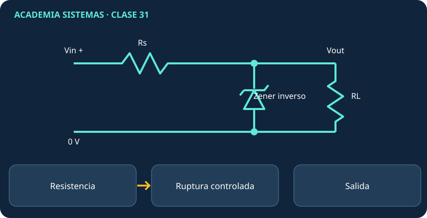

[← Clase](../README.md) · [Índice](../README.md) · [Siguiente →](02.md)

# 31 · 1/4 · Ruptura

Zener diseñado para ruptura inversa permite corriente cerca de Vz mediante túnel o avalancha. Requiere limitar corriente. Tensión depende de corriente y temperatura; Pz=VzIz.

*Esquema didáctico; no es medición ni plano de montaje.*

> **Comprueba:** Dibuja el mecanismo y explica causa, cambio y conservación con tus palabras.

[← Clase](../README.md) · [Índice](../README.md) · [Siguiente →](02.md)
