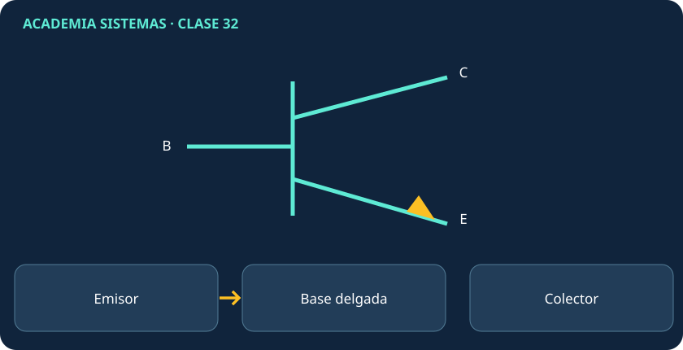

[← Anterior](02.md) · [Índice](../README.md) · [Siguiente →](04.md)

# 32 · 3/4 · Polarización

Resistor de emisor estabiliza punto Q: IE aumenta, VE sube y VBE baja si VB casi fijo. β varía; revisar potencia VCE·IC y margen de salida.

*Esquema didáctico; no es medición ni plano de montaje.*

> **Comprueba:** Dibuja el mecanismo y explica causa, cambio y conservación con tus palabras.

[← Anterior](02.md) · [Índice](../README.md) · [Siguiente →](04.md)
