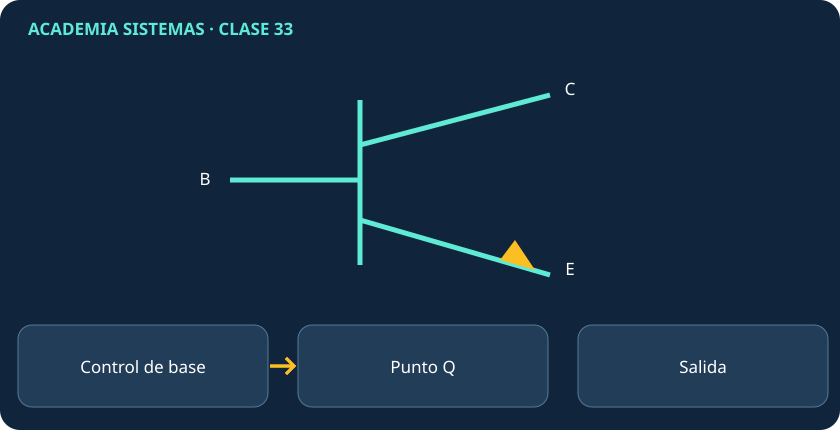

[← Anterior](02.md) · [Índice](../README.md) · [Siguiente →](04.md)

# 33 · 3/4 · Recorte

Corte y saturación impiden proporcionalidad. Escoger Q con margen; resistencia de emisor sin desacoplar reduce ganancia y mejora estabilidad. La fuente entrega energía.

*Esquema didáctico; no es medición ni plano de montaje.*

> **Comprueba:** Dibuja el mecanismo y explica causa, cambio y conservación con tus palabras.

[← Anterior](02.md) · [Índice](../README.md) · [Siguiente →](04.md)
