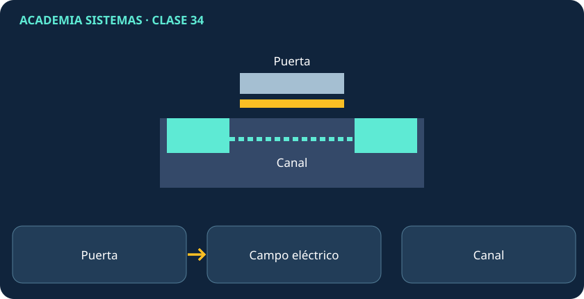

[← Clase](../README.md) · [Índice](../README.md) · [Siguiente →](02.md)

# 34 · 1/4 · Estructura

Puerta aislada controla electrostáticamente superficie entre fuente y drenador. VGS suficiente crea canal de inversión NMOS. Corriente DC de puerta ideal nula; capacitancia exige carga al conmutar.

*Esquema didáctico; no es medición ni plano de montaje.*

> **Comprueba:** Dibuja el mecanismo y explica causa, cambio y conservación con tus palabras.

[← Clase](../README.md) · [Índice](../README.md) · [Siguiente →](02.md)
