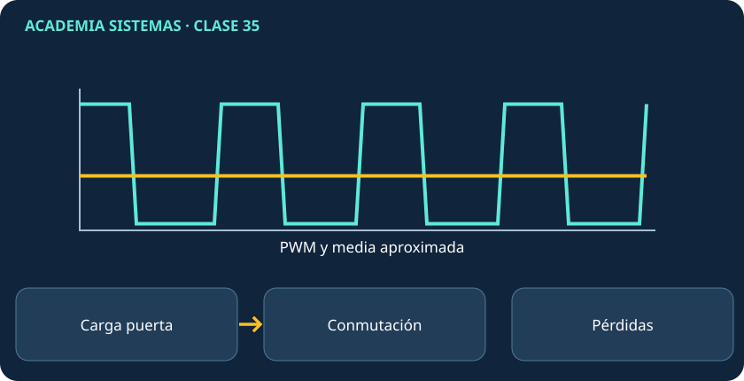

[← Clase](../README.md)

# MOSFET como interruptor y pérdidas

## Conducción

En NMOS de lado bajo, fuente a referencia, drenador a carga. Pcond≈Irms²RDS(on). Con pulsos rectangulares, I²RDS(on)·D. Resistencia varía con temperatura y VGS.

## Conmutación

En flancos coinciden V e I. Psw≈½VDS·ID·(tr+tf)·fs para transiciones lineales. Driver carga puerta; potencia aproximada QgVdrive·fs.

## PWM

Carga resistiva ideal Vmedia=D·V; Pmedia=D·V²/R, no Vmedia²/R. Cargas reactivas requieren otro modelo y ruta de corriente.

## Ejemplo resuelto

5 V, 10 Ω, D=0,4, RDS(on)=0,1 Ω: I≈0,5 A, Pcond≈0,01 W y Pload ideal≈1 W.

**Reto:** ¿Qué pasa al duplicar fs?
