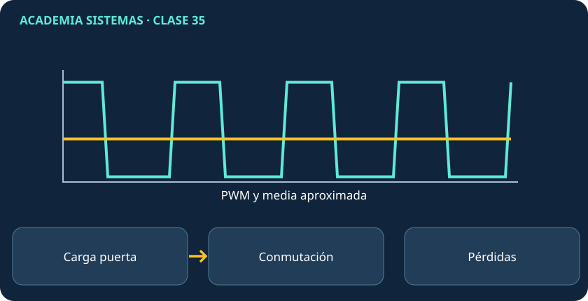

[← Clase](../README.md) · [Índice](../README.md) · [Siguiente →](02.md)

# 35 · 1/4 · Conducción

En NMOS de lado bajo, fuente a referencia, drenador a carga. Pcond≈Irms²RDS(on). Con pulsos rectangulares, I²RDS(on)·D. Resistencia varía con temperatura y VGS.

*Esquema didáctico; no es medición ni plano de montaje.*

> **Comprueba:** Dibuja el mecanismo y explica causa, cambio y conservación con tus palabras.

[← Clase](../README.md) · [Índice](../README.md) · [Siguiente →](02.md)
