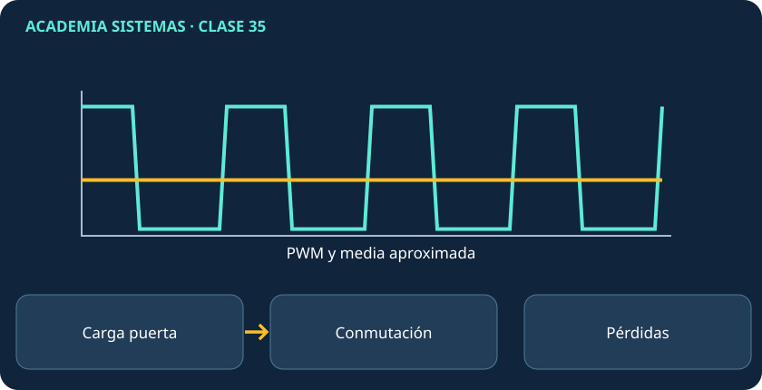

[← Anterior](02.md) · [Índice](../README.md) · [Siguiente →](04.md)

# 35 · 3/4 · PWM

Carga resistiva ideal Vmedia=D·V; Pmedia=D·V²/R, no Vmedia²/R. Cargas reactivas requieren otro modelo y ruta de corriente.

*Esquema didáctico; no es medición ni plano de montaje.*

> **Comprueba:** Dibuja el mecanismo y explica causa, cambio y conservación con tus palabras.

[← Anterior](02.md) · [Índice](../README.md) · [Siguiente →](04.md)
