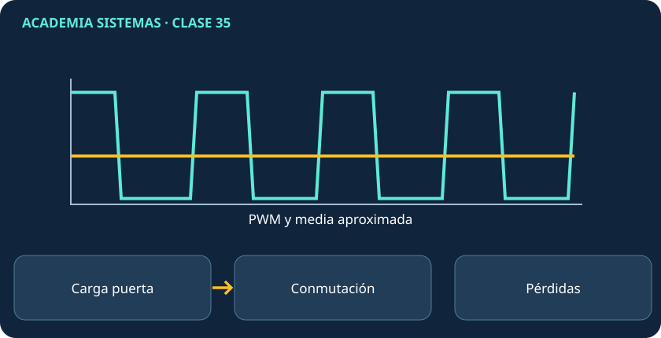

[← Anterior](03.md) · [Índice](../README.md) · [Ejercicios](../ejercicios/README.md) · [Siguiente clase →](../../036-amplificacion/libro/01.md)

# 35 · 4/4 · Ejemplo resuelto

5 V, 10 Ω, D=0,4, RDS(on)=0,1 Ω: I≈0,5 A, Pcond≈0,01 W y Pload ideal≈1 W.

*Esquema didáctico; no es medición ni plano de montaje.*

> **Comprueba:** ¿Qué pasa al duplicar fs?

[← Anterior](03.md) · [Índice](../README.md) · [Ejercicios](../ejercicios/README.md) · [Siguiente clase →](../../036-amplificacion/libro/01.md)
