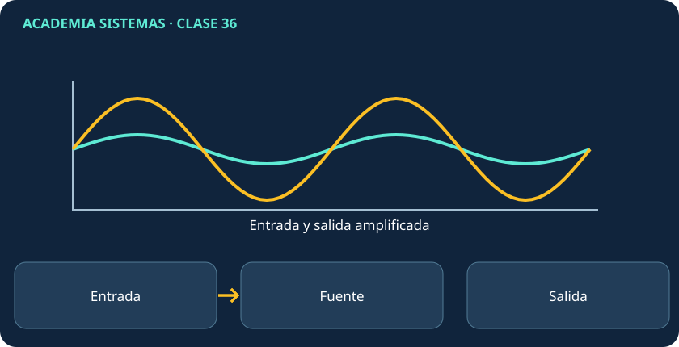

[← Clase](../README.md) · [Índice](../README.md) · [Siguiente →](02.md)

# 36 · 1/4 · Ganancia

Av=Vout/Vin, Ai=Iout/Iin, Ap=Pout/Pin. Tensión en dB=20log10 de magnitud de Av, potencia=10log10 Ap. Energía adicional proviene de fuente.

*Esquema didáctico; no es medición ni plano de montaje.*

> **Comprueba:** Dibuja el mecanismo y explica causa, cambio y conservación con tus palabras.

[← Clase](../README.md) · [Índice](../README.md) · [Siguiente →](02.md)
