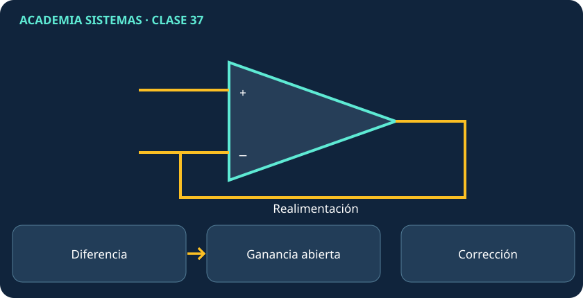

[← Clase](../README.md)

# Amplificador operacional: realimentación y límites

## Lazo abierto

Vout=Aol(V+−V−), limitado por alimentación. Ideal tiene ganancia infinita, entrada sin corriente y salida sin resistencia. Diferencia pequeña puede saturar salida.

## Realimentación

Devolver salida a inversora reduce error ante aumento de salida. En lazo negativo estable y región lineal V+≈V−; no son corto físico. Red fija ganancia cerrada.

## Límites

Revisar modo común, excursión, corriente, offset, ancho de banda, slew rate y estabilidad. Carga capacitiva puede introducir problemas de fase. No asumir entradas iguales en saturación.

## Ejemplo resuelto

Aol=100000, seguidor: ganancia≈0,99999; entrada 1 V da error≈10 µV.

**Reto:** ¿Cuándo falla V+≈V−?
