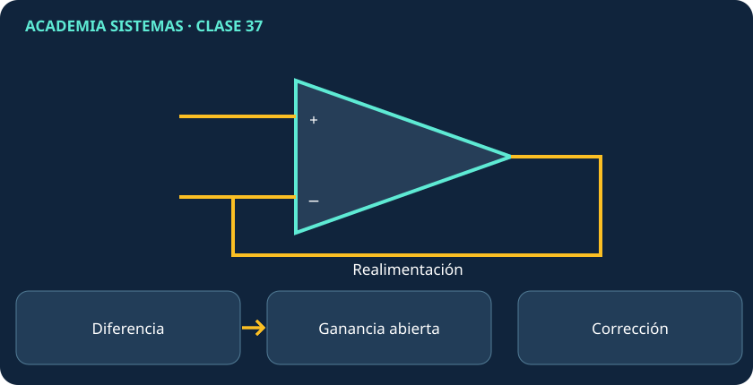

[← Clase](../README.md) · [Índice](../README.md) · [Siguiente →](02.md)

# 37 · 1/4 · Lazo abierto

Vout=Aol(V+−V−), limitado por alimentación. Ideal tiene ganancia infinita, entrada sin corriente y salida sin resistencia. Diferencia pequeña puede saturar salida.

*Esquema didáctico; no es medición ni plano de montaje.*

> **Comprueba:** Dibuja el mecanismo y explica causa, cambio y conservación con tus palabras.

[← Clase](../README.md) · [Índice](../README.md) · [Siguiente →](02.md)
