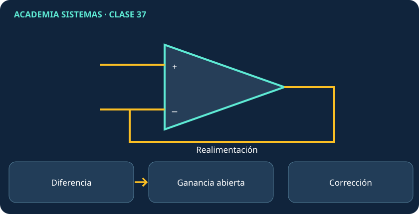

[← Anterior](01.md) · [Índice](../README.md) · [Siguiente →](03.md)

# 37 · 2/4 · Realimentación

Devolver salida a inversora reduce error ante aumento de salida. En lazo negativo estable y región lineal V+≈V−; no son corto físico. Red fija ganancia cerrada.

*Esquema didáctico; no es medición ni plano de montaje.*

> **Comprueba:** Dibuja el mecanismo y explica causa, cambio y conservación con tus palabras.

[← Anterior](01.md) · [Índice](../README.md) · [Siguiente →](03.md)
