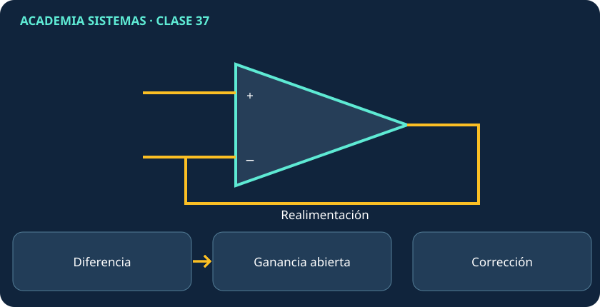

[← Anterior](02.md) · [Índice](../README.md) · [Siguiente →](04.md)

# 37 · 3/4 · Límites

Revisar modo común, excursión, corriente, offset, ancho de banda, slew rate y estabilidad. Carga capacitiva puede introducir problemas de fase. No asumir entradas iguales en saturación.

*Esquema didáctico; no es medición ni plano de montaje.*

> **Comprueba:** Dibuja el mecanismo y explica causa, cambio y conservación con tus palabras.

[← Anterior](02.md) · [Índice](../README.md) · [Siguiente →](04.md)
