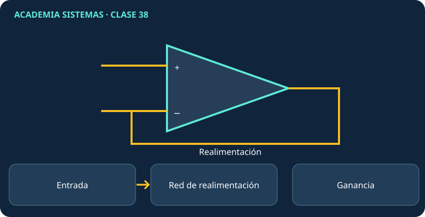

[← Anterior](02.md) · [Índice](../README.md) · [Siguiente →](04.md)

# 38 · 3/4 · Diseño

Resistores bajos cargan salida y muy altos aumentan efectos de ruido y polarización. Revisar tolerancias, modo común, excursión y banda. Fuente simple puede exigir referencia intermedia.

*Esquema didáctico; no es medición ni plano de montaje.*

> **Comprueba:** Dibuja el mecanismo y explica causa, cambio y conservación con tus palabras.

[← Anterior](02.md) · [Índice](../README.md) · [Siguiente →](04.md)
