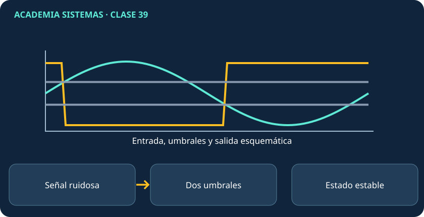

[← Clase 38](../038-opamp-inversor-no-inversor/README.md) · [Índice](../README.md) · [Clase 40 →](../040-filtros-rc/README.md)

# Clase 39 · Comparadores e histéresis

**Edición web inicial · 120 minutos orientativos.**

> ¿Qué salida hay en 2,5 V tras superar 3 V?

[▶ Comenzar](libro/01.md) · [HTML imprimible](libro.html) · [Materiales](descargas.md)

- [Comparador](libro/01.md)
- [Histéresis](libro/02.md)
- [Memoria](libro/03.md)
- [Ejemplo resuelto](libro/04.md)

[Lectura](lecturas/guia-ampliada.md) · [Ejercicios](ejercicios/README.md) · [Laboratorio](practicas/README.md) · [Evaluación](pruebas/README.md) · [Soluciones](soluciones/README.md) · [Guía docente](guia-docente.md)

> Prácticas virtuales. Nunca conectar red doméstica, abrir fuentes ni provocar cortocircuitos. Montajes posteriores solo con supervisión y fuente aislada de baja tensión limitada.

[← Clase 38](../038-opamp-inversor-no-inversor/README.md) · [Índice](../README.md) · [Clase 40 →](../040-filtros-rc/README.md)
