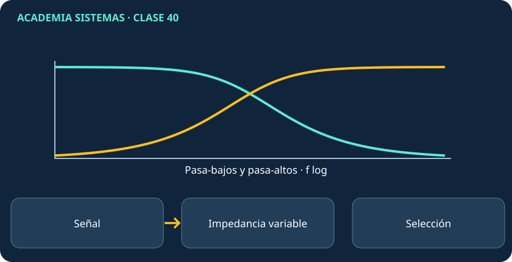

[← Anterior](03.md) · [Índice](../README.md) · [Ejercicios](../ejercicios/README.md) · [Siguiente clase →](../../041-filtros-activos/libro/01.md)

# 40 · 4/4 · Ejemplo resuelto

10 kΩ, 100 nF: fc≈159 Hz. A fc, 1 V pico da 0,707 V; a 1590 Hz≈0,0995 V en pasa-bajos.

*Esquema didáctico; no es medición ni plano de montaje.*

> **Comprueba:** ¿Elimina todas las frecuencias mayores a fc?

[← Anterior](03.md) · [Índice](../README.md) · [Ejercicios](../ejercicios/README.md) · [Siguiente clase →](../../041-filtros-activos/libro/01.md)
