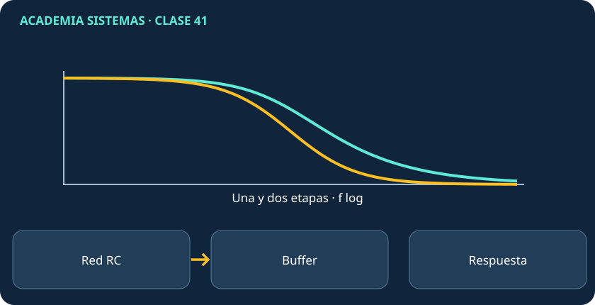

[← Anterior](01.md) · [Índice](../README.md) · [Siguiente →](03.md)

# 41 · 2/4 · Orden

Cada polo aporta −20 dB/década asintóticos. Dos RC aislados idénticos tienen −6 dB en fc individual, no −3. Butterworth segundo orden usa otra distribución de polos. Q controla amortiguamiento.

*Esquema didáctico; no es medición ni plano de montaje.*

> **Comprueba:** Dibuja el mecanismo y explica causa, cambio y conservación con tus palabras.

[← Anterior](01.md) · [Índice](../README.md) · [Siguiente →](03.md)
