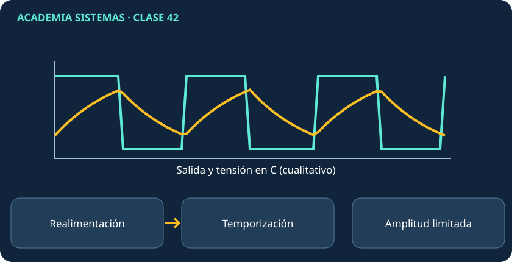

[← Anterior](02.md) · [Índice](../README.md) · [Siguiente →](04.md)

# 42 · 3/4 · Estabilidad

Tolerancia, temperatura, ruido y retardo alteran frecuencia. Cristal aprovecha resonancia mecánica. Distingue periodo, frecuencia, ciclo útil y jitter.

*Esquema didáctico; no es medición ni plano de montaje.*

> **Comprueba:** Dibuja el mecanismo y explica causa, cambio y conservación con tus palabras.

[← Anterior](02.md) · [Índice](../README.md) · [Siguiente →](04.md)
