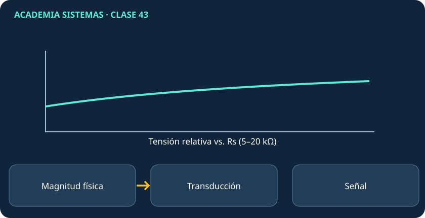

[← Clase](../README.md) · [Índice](../README.md) · [Siguiente →](02.md)

# 43 · 1/4 · Transducción

LDR cambia resistencia con luz, NTC con temperatura. Otros sensores entregan corriente o tensión. Sensibilidad, resolución, exactitud y precisión difieren; calibración usa referencias conocidas.

*Esquema didáctico; no es medición ni plano de montaje.*

> **Comprueba:** Dibuja el mecanismo y explica causa, cambio y conservación con tus palabras.

[← Clase](../README.md) · [Índice](../README.md) · [Siguiente →](02.md)
