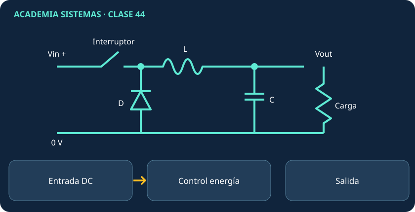

[← Clase](../README.md)

# Reguladores lineales y conmutados: fundamentos

## Lineal

Elemento de paso bajo realimentación. Pérdida≈(Vin−Vout)Iout más consumo propio. Eficiencia aproximada Vout/Vin. Dropout es margen de entrada para regulación.

## Buck

Alterna interruptor y trayectoria de corriente del inductor; condensador filtra. Ideal en conducción continua Vout≈D·Vin por balance volt-segundos. Boost tiene otra relación.

## Selección

η=Pout/Pin. Pérdidas conmutadas en conducción, flancos, núcleo y control; ondulación y EMI dependen de diseño. Lineal puede convenir con poco diferencial o exigencia de ruido.

## Ejemplo resuelto

9 V a 3,3 V a 100 mA: Pout=0,33 W; lineal pierde≈0,57 W; buck hipotético 85 % pierde≈0,058 W.

**Reto:** ¿Vout=D·Vin vale para cualquier convertidor?
