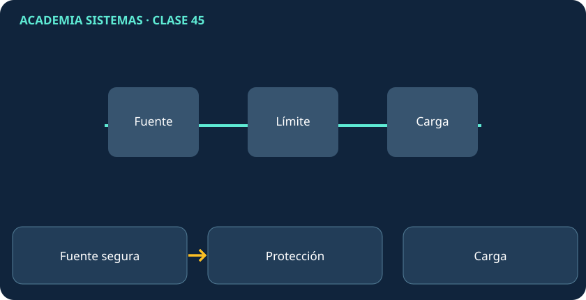

[← Anterior](01.md) · [Índice](../README.md) · [Siguiente →](03.md)

# 45 · 2/4 · Protección

Limitar corriente, polaridad inversa y sobrevoltaje según riesgo. Condensador local suministra transitorios, no sustituye capacidad continua. Caída cable=IR; retorno compartido puede introducir ruido.

*Esquema didáctico; no es medición ni plano de montaje.*

> **Comprueba:** Dibuja el mecanismo y explica causa, cambio y conservación con tus palabras.

[← Anterior](01.md) · [Índice](../README.md) · [Siguiente →](03.md)
