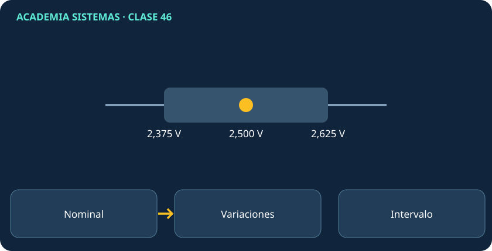

[← Anterior](01.md) · [Índice](../README.md) · [Siguiente →](03.md)

# 46 · 2/4 · Temperatura

R(T)≈R0(1+αΔT) en rango válido. ppm/°C son millonésimas por grado. Capacitores y semiconductores varían también con tensión y envejecimiento.

*Esquema didáctico; no es medición ni plano de montaje.*

> **Comprueba:** Dibuja el mecanismo y explica causa, cambio y conservación con tus palabras.

[← Anterior](01.md) · [Índice](../README.md) · [Siguiente →](03.md)
