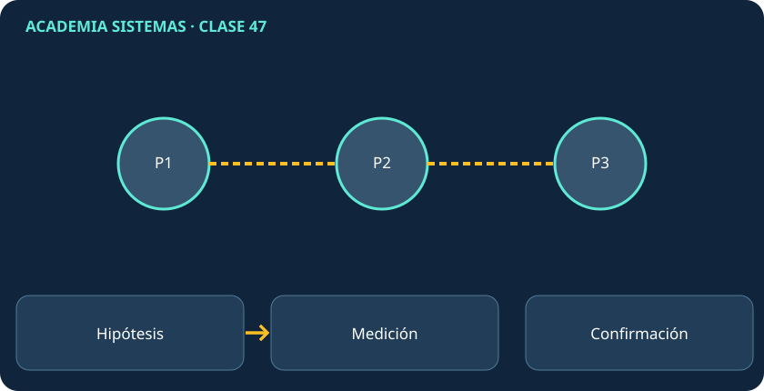

[← Anterior](02.md) · [Índice](../README.md) · [Siguiente →](04.md)

# 47 · 3/4 · Confirmación

Inspecciona continuidad sin energía. Solo energiza con fuente limitada segura. Revisa DC, luego señal y carga; repite pruebas al corregir. Documenta causa raíz y prevención.

*Esquema didáctico; no es medición ni plano de montaje.*

> **Comprueba:** Dibuja el mecanismo y explica causa, cambio y conservación con tus palabras.

[← Anterior](02.md) · [Índice](../README.md) · [Siguiente →](04.md)
