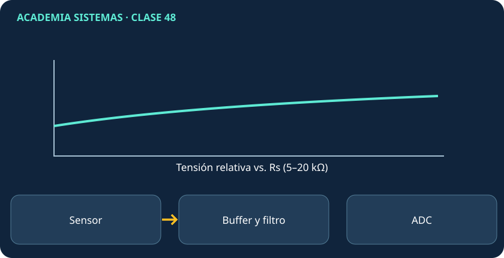

[← Anterior](01.md) · [Índice](../README.md) · [Siguiente →](03.md)

# 48 · 2/4 · Diseño

R fijo 10 kΩ arriba y sensor abajo: salida 1,10–2,20 V. Filtro tras buffer 10 kΩ, 1 µF: fc≈15,9 Hz, τ=10 ms. ADC 10 bits con floor: códigos 341–682.

*Esquema didáctico; no es medición ni plano de montaje.*

> **Comprueba:** Dibuja el mecanismo y explica causa, cambio y conservación con tus palabras.

[← Anterior](01.md) · [Índice](../README.md) · [Siguiente →](03.md)
