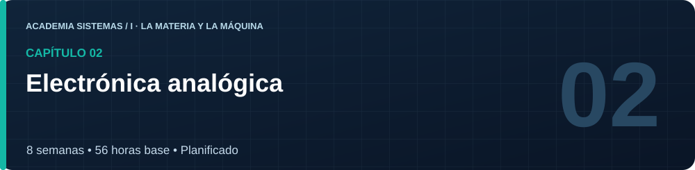

[Inicio](../../../README.md) · [Capítulo](../README.md)

# 24 clases · Electrónica analógica

**Planificación curricular · 8 semanas, 56 horas base.** Materiales completos pendientes. Cada bloque incluye teoría causal, diagramas, simulación, ejercicios, práctica y verificación acumulativa.

| Semana | Clase | Tema |
|---:|---:|---|
| 1 | 001 | Condensadores: dieléctrico, ESR, carga RC y energía |
| 1 | 002 | Inductores: campo, energía magnética, transitorios RL |
| 1 | 003 | Circuitos RLC: resonancia, impedancia y fase |
| 2 | 004 | Transformadores: inducción, relación de espiras, aislamiento y pérdidas |
| 2 | 005 | Unión PN: dopaje, barrera y curva I-V |
| 2 | 006 | Rectificadores y filtrado: ondulación y diodos |
| 3 | 007 | Diodos Zener y regulación |
| 3 | 008 | Transistor BJT: regiones y polarización |
| 3 | 009 | BJT como interruptor y amplificador |
| 4 | 010 | MOSFET: canal, umbral, regiones y protección ESD |
| 4 | 011 | MOSFET como interruptor y pérdidas |
| 4 | 012 | Amplificación y ganancia, saturación y ruido |
| 5 | 013 | Amplificador operacional: realimentación y límites |
| 5 | 014 | Amplificador inversor y no inversor |
| 5 | 015 | Comparadores e histéresis |
| 6 | 016 | Filtros RC pasivos y frecuencia de corte |
| 6 | 017 | Filtros activos y respuesta en frecuencia |
| 6 | 018 | Osciladores y temporización |
| 7 | 019 | Sensores y acondicionamiento de señal |
| 7 | 020 | Reguladores lineales y conmutados: fundamentos |
| 7 | 021 | Fuentes de alimentación DC de bajo voltaje |
| 8 | 022 | Análisis de tolerancias, temperatura y medición |
| 8 | 023 | Diagnóstico analógico y simulación |
| 8 | 024 | Proyecto: sensor con acondicionamiento |

No comenzar sin dominar los prerrequisitos del capítulo anterior. Las prácticas físicas usarán solo baja tensión DC y fuentes apropiadas. Transformadores y rectificación de red se estudian mediante modelos y simulación, no conexiones domésticas.

[← Volver al capítulo](../README.md)
