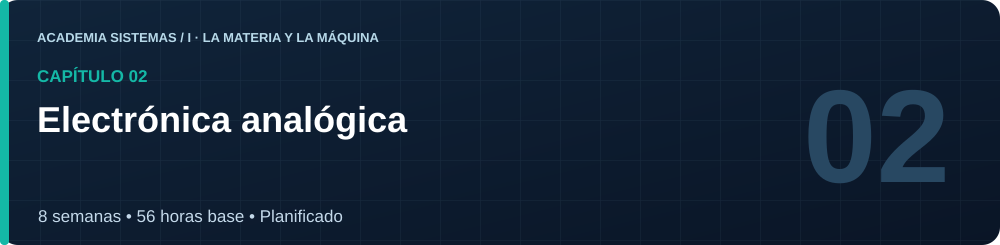

[Inicio](../../../README.md) · [Capítulo 02](../README.md)

# 🧪 Laboratorios

> Electrónica analógica

> [!NOTE]
> Material planificado, todavía no desarrollado. Se incorporará al avanzar en el programa.

Cada práctica incluirá objetivo, materiales, pasos, resultados, seguridad y rúbrica. [Plantilla de informe](../../../plantillas/informe-laboratorio.md).

---

[← Volver al capítulo](../README.md)
