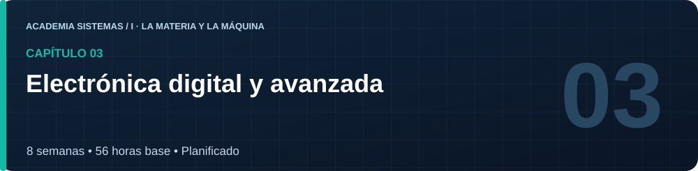

[Inicio](../../../README.md) · [Capítulo](../README.md)

# 24 clases · Electrónica digital

**Planificación curricular · 8 semanas, 56 horas base.** Materiales completos pendientes. Cada bloque incluye teoría causal, diagramas, simulación, ejercicios, práctica y verificación acumulativa.

| Semana | Clase | Tema |
|---:|---:|---|
| 1 | 001 | Señales analógicas y digitales: niveles y umbrales |
| 1 | 002 | Binario, decimal y hexadecimal; conversiones |
| 1 | 003 | Representación de enteros y complemento a dos |
| 2 | 004 | Álgebra de Boole y tablas de verdad |
| 2 | 005 | Compuertas NOT, AND, OR, NAND, NOR, XOR |
| 2 | 006 | Transistores CMOS y compuertas |
| 3 | 007 | Simplificación booleana y mapas de Karnaugh |
| 3 | 008 | Circuitos combinacionales y retardos |
| 3 | 009 | Medio sumador y sumador completo |
| 4 | 010 | Restadores y desbordamiento |
| 4 | 011 | Multiplexores y demultiplexores |
| 4 | 012 | Codificadores y decodificadores |
| 5 | 013 | Comparadores y selección de datos |
| 5 | 014 | Reloj, flancos y sincronización |
| 5 | 015 | Latch y flip-flop SR/D/JK |
| 6 | 016 | Registros y desplazamiento |
| 6 | 017 | Contadores síncronos y asíncronos |
| 6 | 018 | Máquinas de estados finitos |
| 7 | 019 | Memorias SRAM, DRAM y ROM: fundamentos |
| 7 | 020 | Temporización, setup/hold y metastabilidad conceptual |
| 7 | 021 | Diseño de ALU elemental |
| 8 | 022 | Camino de datos, registros y control |
| 8 | 023 | Procesador elemental: ciclo de instrucción |
| 8 | 024 | Proyecto digital: contador y simulación de ALU |

No comenzar sin dominar los prerrequisitos del capítulo anterior. Las prácticas físicas usarán solo baja tensión DC y fuentes apropiadas. Transformadores y rectificación de red se estudian mediante modelos y simulación, no conexiones domésticas.

[← Volver al capítulo](../README.md)
