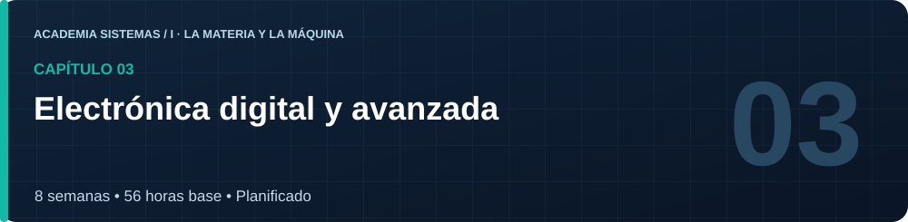

[Inicio](../../../README.md) · [Capítulo 03](../README.md)

# 🛠️ Proyecto integrador

> Electrónica digital y avanzada

> [!NOTE]
> Material planificado, todavía no desarrollado. Se incorporará al avanzar en el programa.

## Reto previsto

Contador digital.

[Ver rúbrica general](../../../plantillas/rubrica-proyecto.md).

---

[← Volver al capítulo](../README.md)
