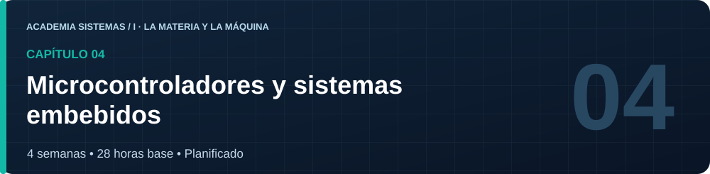

[Inicio](../../../README.md) · [Capítulo 04](../README.md)

# 📖 Clases y lecturas

> Microcontroladores y sistemas embebidos

> [!NOTE]
> Material planificado, todavía no desarrollado. Se incorporará al avanzar en el programa.

## Temario previsto

- GPIO
- C básico
- temporizadores
- PWM
- ADC
- interrupciones
- UART
- I2C
- SPI

[Plantilla de clase](../../../plantillas/clase.md).

---

[← Volver al capítulo](../README.md)
