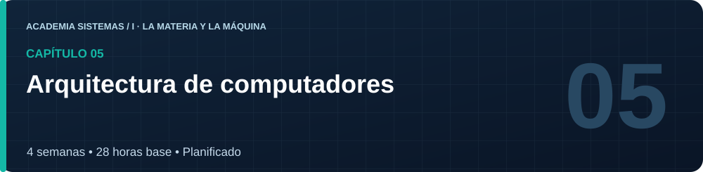

[Inicio](../../README.md) · [Pensum](../../PENSUM.md)

# Capítulo 05 · Arquitectura de computadores

> Este capítulo forma parte de la ruta progresiva; sus materiales completos están planificados.

**4 semanas · 28 horas base · Planificado**

## Qué vas a aprender

- ALU
- CPU
- registros
- memoria
- buses
- ISA
- ciclo de instrucción
- ensamblador y caché

## Biblioteca del capítulo

| Sección | Contenido |
|---|---|
| [📖 Clases](clases/README.md) | Lecturas, presentaciones y actividades |
| [🧪 Laboratorios](laboratorios/README.md) | Experimentos y guías de práctica |
| [📝 Pruebas](pruebas/README.md) | Evaluaciones y criterios |
| [🛠️ Proyecto](proyecto/README.md) | Aplicación integradora |

## Proyecto de cierre

**Simular una CPU elemental**

La guía detallada está pendiente de desarrollo.

---

[← Capítulo 04](../04-microcontroladores/README.md) · [Índice general](../../README.md) · [Capítulo 06 →](../06-matematicas-discretas/README.md)
