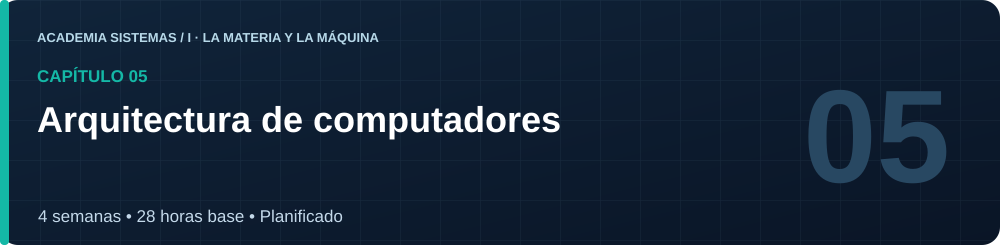

[Inicio](../../../README.md) · [Capítulo 05](../README.md)

# 📖 Clases y lecturas

> Arquitectura de computadores

> [!NOTE]
> Material planificado, todavía no desarrollado. Se incorporará al avanzar en el programa.

## Temario previsto

- ALU
- CPU
- registros
- memoria
- buses
- ISA
- ciclo de instrucción
- ensamblador y caché

[Plantilla de clase](../../../plantillas/clase.md).

---

[← Volver al capítulo](../README.md)
