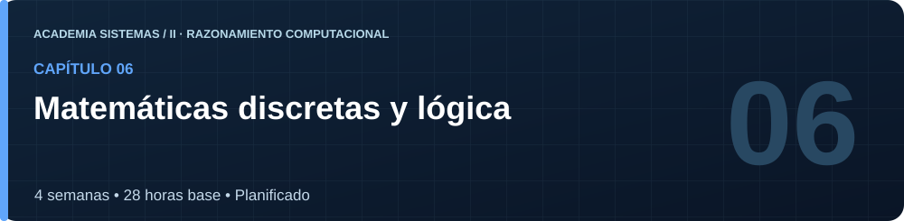

[Inicio](../../README.md) · [Pensum](../../PENSUM.md)

# Capítulo 06 · Matemáticas discretas y lógica

> Este capítulo forma parte de la ruta progresiva; sus materiales completos están planificados.

**4 semanas · 28 horas base · Planificado**

## Qué vas a aprender

- Proposiciones
- demostraciones
- conjuntos
- relaciones
- funciones
- combinatoria y grafos

## Biblioteca del capítulo

| Sección | Contenido |
|---|---|
| [📖 Clases](clases/README.md) | Lecturas, presentaciones y actividades |
| [🧪 Laboratorios](laboratorios/README.md) | Experimentos y guías de práctica |
| [📝 Pruebas](pruebas/README.md) | Evaluaciones y criterios |
| [🛠️ Proyecto](proyecto/README.md) | Aplicación integradora |

## Proyecto de cierre

**Modelar un grafo de conexiones**

La guía detallada está pendiente de desarrollo.

---

[← Capítulo 05](../05-arquitectura-computadores/README.md) · [Índice general](../../README.md) · [Capítulo 07 →](../07-algoritmos/README.md)
