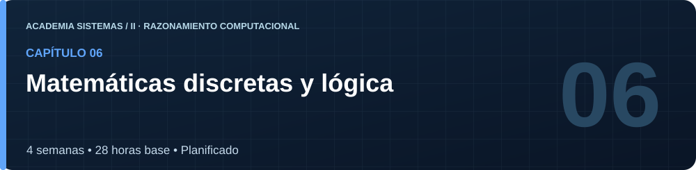

[Inicio](../../../README.md) · [Capítulo 06](../README.md)

# 📖 Clases y lecturas

> Matemáticas discretas y lógica

> [!NOTE]
> Material planificado, todavía no desarrollado. Se incorporará al avanzar en el programa.

## Temario previsto

- Proposiciones
- demostraciones
- conjuntos
- relaciones
- funciones
- combinatoria y grafos

[Plantilla de clase](../../../plantillas/clase.md).

---

[← Volver al capítulo](../README.md)
