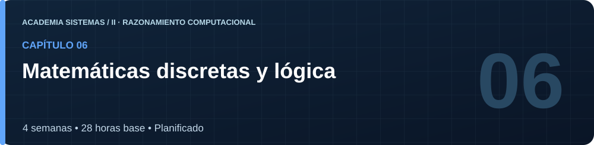

[Inicio](../../../README.md) · [Capítulo 06](../README.md)

# 🛠️ Proyecto integrador

> Matemáticas discretas y lógica

> [!NOTE]
> Material planificado, todavía no desarrollado. Se incorporará al avanzar en el programa.

## Reto previsto

Modelar un grafo de conexiones.

[Ver rúbrica general](../../../plantillas/rubrica-proyecto.md).

---

[← Volver al capítulo](../README.md)
