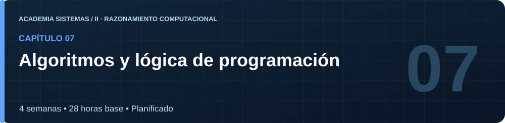

[Inicio](../../README.md) · [Pensum](../../PENSUM.md)

# Capítulo 07 · Algoritmos y lógica de programación

> Este capítulo forma parte de la ruta progresiva; sus materiales completos están planificados.

**4 semanas · 28 horas base · Planificado**

## Qué vas a aprender

- Descomposición
- pseudocódigo
- diagramas
- variables
- tipos
- decisiones
- ciclos y trazas

## Biblioteca del capítulo

| Sección | Contenido |
|---|---|
| [📖 Clases](clases/README.md) | Lecturas, presentaciones y actividades |
| [🧪 Laboratorios](laboratorios/README.md) | Experimentos y guías de práctica |
| [📝 Pruebas](pruebas/README.md) | Evaluaciones y criterios |
| [🛠️ Proyecto](proyecto/README.md) | Aplicación integradora |

## Proyecto de cierre

**Algoritmo de gestión de inventario**

La guía detallada está pendiente de desarrollo.

---

[← Capítulo 06](../06-matematicas-discretas/README.md) · [Índice general](../../README.md) · [Capítulo 08 →](../08-programacion-estructurada/README.md)
