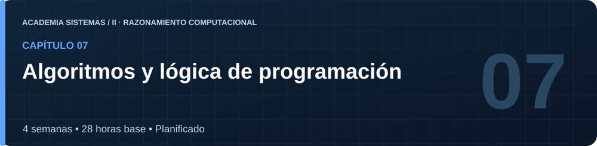

[Inicio](../../../README.md) · [Capítulo 07](../README.md)

# 📖 Clases y lecturas

> Algoritmos y lógica de programación

> [!NOTE]
> Material planificado, todavía no desarrollado. Se incorporará al avanzar en el programa.

## Temario previsto

- Descomposición
- pseudocódigo
- diagramas
- variables
- tipos
- decisiones
- ciclos y trazas

[Plantilla de clase](../../../plantillas/clase.md).

---

[← Volver al capítulo](../README.md)
