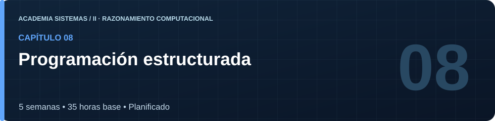

[Inicio](../../../README.md) · [Capítulo 08](../README.md)

# 📖 Clases y lecturas

> Programación estructurada

> [!NOTE]
> Material planificado, todavía no desarrollado. Se incorporará al avanzar en el programa.

## Temario previsto

- Python
- funciones
- módulos
- colecciones
- archivos
- excepciones
- pruebas básicas

[Plantilla de clase](../../../plantillas/clase.md).

---

[← Volver al capítulo](../README.md)
