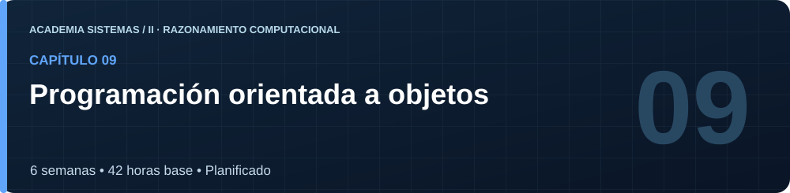

[Inicio](../../README.md) · [Pensum](../../PENSUM.md)

# Capítulo 09 · Programación orientada a objetos

> Este capítulo forma parte de la ruta progresiva; sus materiales completos están planificados.

**6 semanas · 42 horas base · Planificado**

## Qué vas a aprender

- Java
- JVM
- clases
- objetos
- encapsulación
- composición
- interfaces
- herencia
- polimorfismo y pruebas

## Biblioteca del capítulo

| Sección | Contenido |
|---|---|
| [📖 Clases](clases/README.md) | Lecturas, presentaciones y actividades |
| [🧪 Laboratorios](laboratorios/README.md) | Experimentos y guías de práctica |
| [📝 Pruebas](pruebas/README.md) | Evaluaciones y criterios |
| [🛠️ Proyecto](proyecto/README.md) | Aplicación integradora |

## Proyecto de cierre

**Sistema de biblioteca en Java**

La guía detallada está pendiente de desarrollo.

---

[← Capítulo 08](../08-programacion-estructurada/README.md) · [Índice general](../../README.md) · [Capítulo 10 →](../10-estructuras-datos/README.md)
