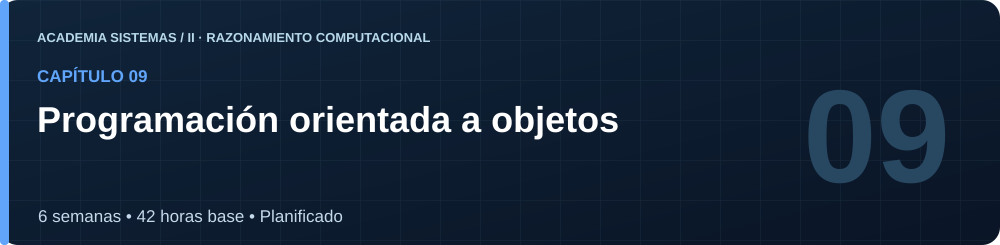

[Inicio](../../../README.md) · [Capítulo 09](../README.md)

# 📖 Clases y lecturas

> Programación orientada a objetos

> [!NOTE]
> Material planificado, todavía no desarrollado. Se incorporará al avanzar en el programa.

## Temario previsto

- Java
- JVM
- clases
- objetos
- encapsulación
- composición
- interfaces
- herencia
- polimorfismo y pruebas

[Plantilla de clase](../../../plantillas/clase.md).

---

[← Volver al capítulo](../README.md)
