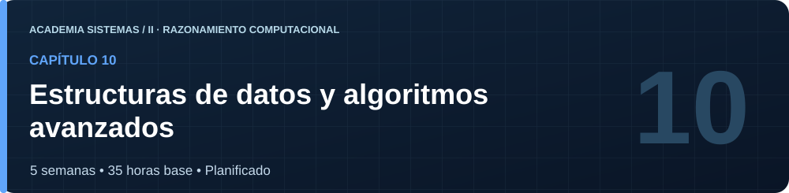

[Inicio](../../../README.md) · [Capítulo 10](../README.md)

# 📖 Clases y lecturas

> Estructuras de datos y algoritmos avanzados

> [!NOTE]
> Material planificado, todavía no desarrollado. Se incorporará al avanzar en el programa.

## Temario previsto

- Complejidad
- listas
- pilas
- colas
- mapas
- árboles
- grafos
- búsqueda y ordenamiento

[Plantilla de clase](../../../plantillas/clase.md).

---

[← Volver al capítulo](../README.md)
