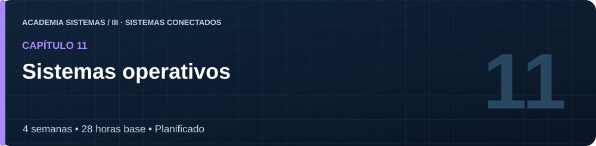

[Inicio](../../../README.md) · [Capítulo 11](../README.md)

# 📖 Clases y lecturas

> Sistemas operativos

> [!NOTE]
> Material planificado, todavía no desarrollado. Se incorporará al avanzar en el programa.

## Temario previsto

- Linux
- terminal
- procesos
- hilos
- memoria virtual
- archivos
- permisos y planificación

[Plantilla de clase](../../../plantillas/clase.md).

---

[← Volver al capítulo](../README.md)
