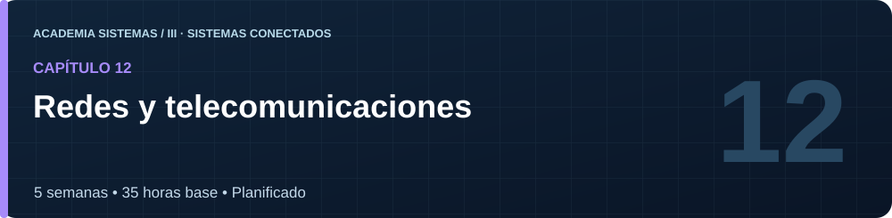

[Inicio](../../README.md) · [Pensum](../../PENSUM.md)

# Capítulo 12 · Redes y telecomunicaciones

> Este capítulo forma parte de la ruta progresiva; sus materiales completos están planificados.

**5 semanas · 35 horas base · Planificado**

## Qué vas a aprender

- OSI
- TCP/IP
- Ethernet
- direccionamiento
- subredes
- DNS
- DHCP
- HTTP y TLS

## Biblioteca del capítulo

| Sección | Contenido |
|---|---|
| [📖 Clases](clases/README.md) | Lecturas, presentaciones y actividades |
| [🧪 Laboratorios](laboratorios/README.md) | Experimentos y guías de práctica |
| [📝 Pruebas](pruebas/README.md) | Evaluaciones y criterios |
| [🛠️ Proyecto](proyecto/README.md) | Aplicación integradora |

## Proyecto de cierre

**Laboratorio cliente-servidor**

La guía detallada está pendiente de desarrollo.

---

[← Capítulo 11](../11-sistemas-operativos/README.md) · [Índice general](../../README.md) · [Capítulo 13 →](../13-bases-datos/README.md)
