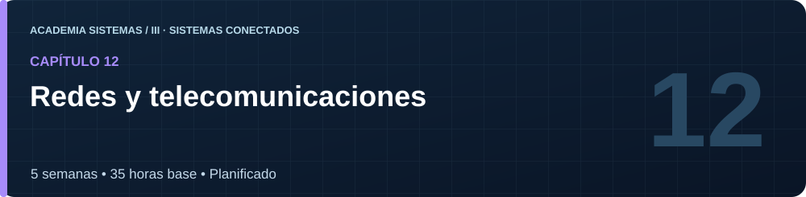

[Inicio](../../../README.md) · [Capítulo 12](../README.md)

# 📖 Clases y lecturas

> Redes y telecomunicaciones

> [!NOTE]
> Material planificado, todavía no desarrollado. Se incorporará al avanzar en el programa.

## Temario previsto

- OSI
- TCP/IP
- Ethernet
- direccionamiento
- subredes
- DNS
- DHCP
- HTTP y TLS

[Plantilla de clase](../../../plantillas/clase.md).

---

[← Volver al capítulo](../README.md)
