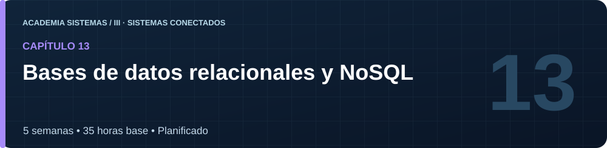

[Inicio](../../../README.md) · [Capítulo 13](../README.md)

# 📖 Clases y lecturas

> Bases de datos relacionales y NoSQL

> [!NOTE]
> Material planificado, todavía no desarrollado. Se incorporará al avanzar en el programa.

## Temario previsto

- Modelado ER
- SQL
- PostgreSQL
- normalización
- índices
- transacciones y documentos

[Plantilla de clase](../../../plantillas/clase.md).

---

[← Volver al capítulo](../README.md)
