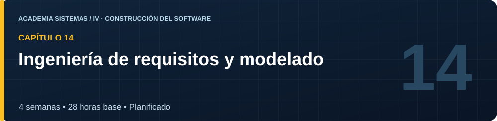

[Inicio](../../../README.md) · [Capítulo 14](../README.md)

# 📖 Clases y lecturas

> Ingeniería de requisitos y modelado

> [!NOTE]
> Material planificado, todavía no desarrollado. Se incorporará al avanzar en el programa.

## Temario previsto

- Requisitos funcionales y no funcionales
- historias
- UML
- trazabilidad y validación

[Plantilla de clase](../../../plantillas/clase.md).

---

[← Volver al capítulo](../README.md)
