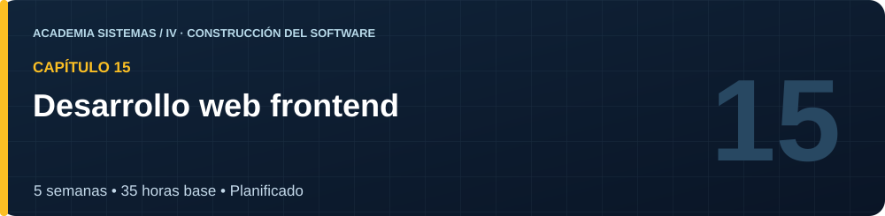

[Inicio](../../README.md) · [Pensum](../../PENSUM.md)

# Capítulo 15 · Desarrollo web frontend

> Este capítulo forma parte de la ruta progresiva; sus materiales completos están planificados.

**5 semanas · 35 horas base · Planificado**

## Qué vas a aprender

- HTML
- CSS
- JavaScript
- DOM
- accesibilidad
- consumo de API y framework frontend

## Biblioteca del capítulo

| Sección | Contenido |
|---|---|
| [📖 Clases](clases/README.md) | Lecturas, presentaciones y actividades |
| [🧪 Laboratorios](laboratorios/README.md) | Experimentos y guías de práctica |
| [📝 Pruebas](pruebas/README.md) | Evaluaciones y criterios |
| [🛠️ Proyecto](proyecto/README.md) | Aplicación integradora |

## Proyecto de cierre

**Interfaz de administración**

La guía detallada está pendiente de desarrollo.

---

[← Capítulo 14](../14-ingenieria-requisitos/README.md) · [Índice general](../../README.md) · [Capítulo 16 →](../16-backend/README.md)
